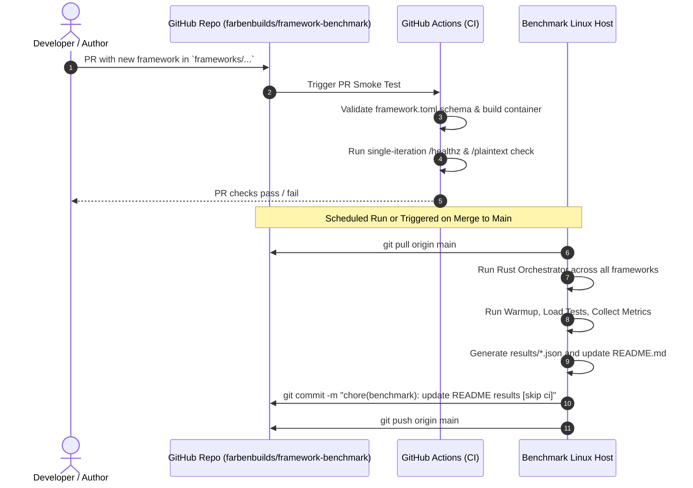

# Multi-Language Server/Client Framework Benchmark Platform Roadmap

Welcome to the **Framework Benchmark** project roadmap. This document outlines the end-to-end blueprint, architecture, technical specifications, and actionable phases for both human developers and autonomous AI agents to build a high-performance, reproducible benchmark suite on bare-metal/cloud Linux systems.

Inspired by [TechEmpower FrameworkBenchmarks](https://github.com/TechEmpower/FrameworkBenchmarks) and [HttpArena](https://github.com/MDA2AV/HttpArena), this platform provides multi-tier workload categories (plaintext, JSON, database queries, template rendering, WebSockets, client benchmarks), multi-runtime orchestration in **Rust**, dual libc ecosystem support (**glibc** and **musl**), declarative framework contributions via **Docker** and **Nix**, and automated result publication back to GitHub.

---

## Table of Contents

1. [Architecture & System Design](#1-architecture--system-design)
2. [Target Benchmark Categories](#2-target-benchmark-categories)
3. [Framework Integration Contract (`frameworks/`)](#3-framework-integration-contract-frameworks)
4. [Dual Libc Support: Glibc & Musl Strategy](#4-dual-libc-support-glibc--musl-strategy)
5. [Linux System & Kernel Tuning Specification](#5-linux-system--kernel-tuning-specification)
6. [Rust Benchmark Orchestrator & Load Engine](#6-rust-benchmark-orchestrator--load-engine)
7. [GitHub Orchestration & Result Publishing Pipeline](#7-github-orchestration--result-publishing-pipeline)
8. [Phased Actionable Roadmap (Human & Agent Checklists)](#8-phased-actionable-roadmap-human--agent-checklists)
   - [Phase 1: Project Foundation & Specification Standards](#phase-1-project-foundation--specification-standards)
   - [Phase 2: Nix Flakes & Docker Dual-Libc Infrastructure](#phase-2-nix-flakes--docker-dual-libc-infrastructure)
   - [Phase 3: Rust Core Engine (Load Generator & Metric Harvester)](#phase-3-rust-core-engine-load-generator--metric-harvester)
   - [Phase 4: Framework Registry & Baseline Implementations](#phase-4-framework-registry--baseline-implementations)
   - [Phase 5: Aggregation, Metrics Processing & README Markdown Engine](#phase-5-aggregation-metrics-processing--readme-markdown-engine)
   - [Phase 6: Bare-Metal Linux Agent & Deployment Scripts](#phase-6-bare-metal-linux-agent--deployment-scripts)
   - [Phase 7: GitHub Actions CI/CD & Automated Pull / Push Lifecycle](#phase-7-github-actions-cicd--automated-pull--push-lifecycle)
9. [Verification & Acceptance Criteria](#9-verification--acceptance-criteria)

---

## 1. Architecture & System Design

```
+-------------------------------------------------------------------------------------------------+
|                                    GitHub Repository                                            |
|  - frameworks/ (declarative definitions, source code, Nix flakes, Dockerfiles)                  |
|  - results/ (raw JSON data, history, latency distribution snapshots)                           |
|  - README.md (auto-updated leaderboards, latency & throughput graphs)                           |
+-------------------------------------------------+-----------------------------------------------+
                                                  |
                         git clone / pull / dispatch webhook
                                                  v
+-------------------------------------------------------------------------------------------------+
|                                Dedicated Linux Benchmark Host                                  |
|                                                                                                 |
|  +-------------------------------------------------------------------------------------------+  |
|  |                    Rust Benchmark Orchestrator (`cargo run -p bench-runner`)              |  |
|  |                                                                                           |  |
|  |  +--------------------+   +-----------------------+   +--------------------------------+  |  |
|  |  | Framework Manager  |   | Load Engine           |   | Resource Collector             |  |  |
|  |  | - Nix / Docker env |   | - HTTP/1.1, H2, H3    |   | - cgroups v2 / /proc / sysinfo |  |  |
|  |  | - Glibc vs Musl    |   | - Tokio / io_uring    |   | - Peak RSS & Working Set RAM   |  |  |
|  |  | - Core isolation   |   | - HDR Histogram       |   | - CPU % (User/Sys) & Context Sw|  |  |
|  |  | - Warmup & Health  |   | - Coordinated Omission|   | - Network & Socket allocations |  |  |
|  |  +---------+----------+   +-----------+-----------+   +---------------+----------------+  |  |
|  +------------|--------------------------|-------------------------------|-------------------+  |
|               |                          |                               |                      |
|               v                          v                               v                      |
|  +------------------------+  +-----------------------+  +------------------------------------+  |
|  | Framework Under Test   |  | Synthetic Traffic     |  | Result Engine                      |  |
|  | (Isolated CPU Cores)   |<-(Traffic via Loopback   |  | - JSON Artifacts (`results/*.json`)|  |
|  | Port: 8080             |   or 10/40GbE link)      |  | - Markdown Tables & SVG Badges     |  |
|  +------------------------+                          |  | - Git Commit & Push to GitHub      |  |
|                                                         +-----------------+------------------+  |
+---------------------------------------------------------------------------|---------------------+
                                                                            |
                                                                   git push results & README.md
                                                                            v
                                                          [ Updated GitHub Repo & Dashboard ]
```

---

## 2. Target Benchmark Categories

To provide depth matching TechEmpower and HttpArena, the platform supports both **Server** and **Client** benchmark suites across several workload classifications:

### A. Server Test Matrix
1. **Plaintext (`/plaintext`)**:
   - Responds with `Hello, World!` formatted as `text/plain`.
   - Tests pure HTTP protocol framing, parser overhead, connection concurrency, and pipelining efficiency.
   - Headers: `Content-Type: text/plain`, `Content-Length`, `Date`, `Server` (optional).
2. **JSON Serialization (`/json`)**:
   - Responds with `{"message":"Hello, World!"}` formatted as `application/json`.
   - Evaluates language-level JSON encoders/serializers and memory allocation patterns under heavy load.
3. **Single Database Query (`/db`)**:
   - Queries a single random row from a PostgreSQL/MySQL database by primary key and serializes to JSON.
   - Evaluates driver performance, connection pool overhead, and asynchronous I/O dispatch.
4. **Multiple Database Queries (`/queries?queries=N`)**:
   - Fetches $N$ random rows (e.g. $N=20$) concurrently or sequentially and returns a JSON array.
   - Stresses database connection multiplexing and batch query scheduling.
5. **Fortunes / Server-Side HTML Rendering (`/fortunes`)**:
   - Reads all rows from a database table, adds one synthetic message, sorts them alphabetically by message, and renders an HTML5 template with strict HTML entity escaping.
   - Evaluates template engines, string allocation, and sorting algorithms.
6. **Data Updates (`/updates?queries=N`)**:
   - Reads $N$ rows, updates a field with a random integer, persists changes to the database, and returns updated records as JSON.
   - Evaluates database transaction handling and write throughput.
7. **Protocol Variations**:
   - HTTP/1.1 Keep-Alive vs Non-Keep-Alive (connection churn).
   - HTTP/1.1 Pipelining (16, 64 depth).
   - HTTP/2 Multiplexing over single and multiple TCP connections.
   - HTTP/3 (QUIC / UDP) where supported.
8. **Concurrency Scaling Tiers**:
   - Tested at 16, 64, 256, 1,024, 4,096, 16,384, and 65,536 (C64K) concurrent connections.
9. **Real-time / WebSocket Echo (`/ws-echo`)**:
   - Measures frame round-trip latency and message throughput under high bi-directional load.

### B. Client Test Matrix
1. **Client Request Throughput**:
   - Measures requests-per-second and connection reuse efficiency of client libraries against a standardized mock upstream server.
2. **Connection Pool Contention**:
   - Stresses client connection pools under thread contention and async queue saturation.
3. **Streaming & Large Payload Handling**:
   - Tests chunked transfer decoding, backpressure compliance, and memory footprint when receiving large streams (1MB, 10MB, 100MB).

### C. Captured Metrics per Test
- **Throughput**: Requests/sec (RPS), Transfer bandwidth (MB/s).
- **Latency Distribution**: Min, P50, P75, P90, P99, P99.9, P99.99, Max, and Standard Deviation (with Coordinated Omission correction via HDR Histogram).
- **Resource Utilization**: Peak Resident Set Size (RSS), Working Set RAM, CPU usage breakdown (User % vs System/Kernel %), Minor/Major page faults, Context switches (voluntary vs involuntary).
- **Network / Socket Health**: Time-Wait sockets, TCP retransmissions, Socket allocs, Ephemeral port exhaustion counts.
- **Reliability & Correctness**: HTTP 2xx vs 4xx vs 5xx counts, Read/Write timeouts, Connection resets, Payload integrity validation.

---

## 3. Framework Integration Contract (`frameworks/`)

Every framework submitted by community authors lives inside the `frameworks/` folder.

### Directory Structure
```
frameworks/
├── <category>/                        # e.g., web-server, client, websocket
│   └── <language>/                    # e.g., rust, go, csharp, node, python, cplusplus, zig
│       └── <framework-name>/          # e.g., axum, actix-web, gin, fasthttp, aspnetcore, fastify
│           ├── framework.toml         # Framework manifest & configuration metadata
│           ├── Dockerfile.glibc       # glibc-based container definition
│           ├── Dockerfile.musl        # musl-based container definition
│           ├── flake.nix              # Nix flake providing both glibc & musl derivations
│           ├── src/                   # Framework source code
│           └── README.md              # Author notes, dependencies, benchmark arguments
```

### Standard Manifest: `framework.toml`
```toml
[framework]
name = "axum"
version = "0.8"
language = "rust"
language_version = "1.85"
website = "https://github.com/tokio-rs/axum"
category = "web-server"
tier = "micro" # "raw" | "micro" | "full-stack"

[capabilities]
plaintext = true
json = true
db_single = true
db_multi = true
fortunes = true
updates = true
websocket = false
http2 = true
http3 = false

[build]
# Default build engine ("nix" or "docker")
engine = "docker"

[build.docker]
dockerfile_glibc = "Dockerfile.glibc"
dockerfile_musl = "Dockerfile.musl"
build_args = { TARGET = "release" }

[build.nix]
flake_attr_glibc = "packages.x86_64-linux.server-glibc"
flake_attr_musl = "packages.x86_64-linux.server-musl"

[runtime]
port = 8080
healthcheck_path = "/healthz"
startup_timeout_seconds = 30
shutdown_signal = "SIGTERM"
environment = { RUST_LOG = "error", PORT = "8080" }
```

### Framework Endpoint Contract
| Route | Method | Expected Output | Content-Type | Status |
|---|---|---|---|---|
| `/healthz` | GET | `OK` or `{"status":"ok"}` | `text/plain` or `application/json` | `200` |
| `/plaintext` | GET | `Hello, World!` | `text/plain` | `200` |
| `/json` | GET | `{"message":"Hello, World!"}` | `application/json` | `200` |
| `/db` | GET | `{"id":42,"randomnumber":7831}` | `application/json` | `200` |
| `/queries?queries=N` | GET | Array of $N$ objects | `application/json` | `200` |
| `/fortunes` | GET | HTML table with escaped entries | `text/html; charset=utf-8` | `200` |
| `/updates?queries=N` | GET | Array of updated objects | `application/json` | `200` |

---

## 4. Dual Libc Support: Glibc & Musl Strategy

Performance characteristics differ significantly between standard GNU C Library (`glibc`) and `musl` libc due to memory allocator designs (ptmalloc vs musl-allocator/mallocng), thread scheduling, and static compilation models. Benchmarking both provides invaluable insights for production container choices (e.g., Alpine vs Debian/Ubuntu/Wolfi).

### Container Build Strategy
- **`Dockerfile.glibc`**:
  - Base: Debian Slim (`debian:bookworm-slim`), Ubuntu minimal, or Wolfi-glibc.
  - Multi-stage build compiling optimized dynamic binaries.
- **`Dockerfile.musl`**:
  - Base: Alpine Linux (`alpine:3.21`) or scratch/distroless-musl.
  - Multi-stage build producing static or musl-dynamically linked binaries.
  - Optional support for memory allocator overrides (e.g., `jemalloc` / `mimalloc` vs default musl mallocng) declared via metadata.

### Nix Flake Strategy (`flake.nix`)
Each framework flake must expose both glibc and musl derivations using Nixpkgs cross-compilation or native stdenv:
```nix
{
  description = "Axum benchmark package";

  inputs = {
    nixpkgs.url = "github:NixOS/nixpkgs/nixos-unstable";
    flake-utils.url = "github:numtide/flake-utils";
  };

  outputs = { self, nixpkgs, flake-utils }:
    flake-utils.lib.eachDefaultSystem (system:
      let
        pkgs = import nixpkgs { inherit system; };
        pkgsMusl = pkgs.pkgsMusl;
      in {
        packages = {
          # glibc target
          server-glibc = pkgs.rustPlatform.buildRustPackage {
            pname = "axum-bench-glibc";
            version = "0.1.0";
            src = ./.;
            cargoLock.lockFile = ./Cargo.lock;
          };

          # musl target
          server-musl = pkgsMusl.rustPlatform.buildRustPackage {
            pname = "axum-bench-musl";
            version = "0.1.0";
            src = ./.;
            cargoLock.lockFile = ./Cargo.lock;
          };
        };
      }
    );
}
```

---

## 5. Linux System & Kernel Tuning Specification

To ensure deterministic, jitter-free benchmark results on the Linux runner, the host must apply specialized OS configurations:

### CPU & Scheduling
- **CPU Governor**: Set to `performance` on all cores (`cpupower frequency-set -g performance`).
- **Core Isolation (`isolcpus`)**:
  - Isolate dedicated cores (e.g., Cores 2-7) for the server framework under test.
  - Assign separate dedicated cores (e.g., Cores 8-15) for the load generator to prevent client/server contention.
  - Core 0-1 reserved for OS kernel interrupts and collector daemons.
- **Turboboost / Thermal Throttling**:
  - Lock CPU frequency or monitor thermal throttling registers (`msr`) to reject runs where frequency dropped.

### Kernel Sysctl Tuning (`/etc/sysctl.d/99-benchmark.conf`)
```ini
# Maximum socket listen backlog
net.core.somaxconn = 65535
net.ipv4.tcp_max_syn_backlog = 65535

# Increase ephemeral port range
net.ipv4.ip_local_port_range = 1024 65535

# Allow reuse of TIME_WAIT sockets
net.ipv4.tcp_tw_reuse = 1

# Disable TCP slow start after idle
net.ipv4.tcp_slow_start_after_idle = 0

# Socket buffer sizes (max 16MB)
net.core.rmem_max = 16777216
net.core.wmem_max = 16777216
net.ipv4.tcp_rmem = 4096 87380 16777216
net.ipv4.tcp_wmem = 4096 65536 16777216

# File descriptor limits
fs.file-max = 2097152
```

---

## 6. Rust Benchmark Orchestrator & Load Engine

The core benchmark utility is written in **Rust** for maximum efficiency, memory safety, minimal runtime overhead, and cross-platform compilation.

### Workspace Structure
```
crates/
├── orchestrator/      # CLI runner, test scheduler, container/nix lifecycle manager
├── load-generator/    # High-throughput asynchronous HTTP/WS load generator
├── collector/         # Linux cgroups v2, /proc, and eBPF resource monitor
├── reporter/          # Markdown table generator, SVG chart plotter, JSON serializer
└── common/            # Shared types, framework manifest schemas, configuration models
```

### Key Components
1. **Load Generator Engine**:
   - Built on `tokio`, `hyper`, and optional `io_uring` driver.
   - Implements **HDR Histogram** for recording latencies from 1 microsecond to 100 seconds with sub-percentile accuracy.
   - Compensates for **Coordinated Omission** using constant-rate request generation models.
   - Supports HTTP/1.1 pipelining, HTTP/2 multiplexed streams, and HTTP/3 QUIC frames.
2. **Lifecycle & Isolation Manager**:
   - Launches frameworks via Docker API (`bollard`) or native Nix process execution.
   - Enforces CPU affinity (`core_affinity` / `nix::sched_setaffinity`) and cgroups v2 memory limits.
   - Waits for `/healthz` readiness probe with exponential backoff before triggering benchmarks.
   - Enforces a Warmup period (e.g., 15 seconds) to allow JIT compilation (Java, C#, V8, PyPy) to stabilize before sampling.
   - Enforces a Cooldown period between benchmark rounds to let TCP sockets drain and OS buffers flush.
3. **Resource Sampler**:
   - Samples `/proc/[pid]/stat`, `/proc/[pid]/status`, and `/sys/fs/cgroup/` at 100ms intervals.
   - Tracks RSS, VSS, dirty pages, user/kernel CPU percentages, and page fault counters.
4. **Reporter**:
   - Emits structured JSON files under `results/data/<run-id>.json`.
   - Generates responsive GitHub-flavored Markdown tables with emoji medals (🥇, 🥈, 🥉).
   - Generates interactive or SVG bar charts showing Throughput (RPS) vs P99 Latency vs Peak Memory.

---

## 7. GitHub Orchestration & Result Publishing Pipeline



---

## 8. Phased Actionable Roadmap (Human & Agent Checklists)

### Phase 1: Project Foundation & Specification Standards
- [ ] **1.1 Workspace Setup & Repository Skeleton** `[Shared]`
  - Initialize standard root directory structure: `crates/`, `frameworks/`, `scripts/`, `results/`, `.github/`.
  - Create root `Cargo.toml` workspace defining `orchestrator`, `load-generator`, `collector`, `reporter`, and `common`.
  - Add root `.gitignore` ignoring target folders, results cache, and temporary Docker/Nix artifacts.
- [ ] **1.2 Framework Manifest Specification (`common`)** `[Rust Agent]`
  - Implement `framework.toml` schema parsing using `serde` and `toml`.
  - Define data structures for `FrameworkManifest`, `Capabilities`, `BuildEngine`, `RuntimeConfig`.
  - Write unit tests validating valid and invalid manifest files.
- [ ] **1.3 Result Schema Specification** `[Rust Agent]`
  - Define standard JSON output schema (`RunResult`, `TestMetrics`, `LatencyDistribution`, `ResourceUsage`).
  - Document JSON schema in `docs/schemas/result-schema.json`.

---

### Phase 2: Nix Flakes & Docker Dual-Libc Infrastructure
- [ ] **2.1 Standard Nix Flake Templates** `[Human / Agent]`
  - Create base templates in `templates/nix/` demonstrating dual `server-glibc` and `server-musl` derivations.
  - Implement Nix flake verification scripts validating builds in isolated environments.
- [ ] **2.2 Standard Dockerfile Templates** `[Human / Agent]`
  - Create `templates/docker/Dockerfile.glibc` (Debian slim multi-stage).
  - Create `templates/docker/Dockerfile.musl` (Alpine Linux multi-stage with static linking / musl).
  - Create Docker build helper script supporting build arguments and caching.
- [ ] **2.3 Database Test Environment Containers** `[Agent]`
  - Provide `docker-compose.db.yml` or container launch commands for PostgreSQL / MySQL initialized with TechEmpower-compatible `World` and `Fortune` test tables.
  - Provide seed script populating 10,000 rows in test database.

---

### Phase 3: Rust Core Engine (Load Generator & Metric Harvester)
- [ ] **3.1 High-Performance Load Generator (`load-generator`)** `[Rust Agent]`
  - Implement multi-threaded async HTTP client engine using `tokio` and `hyper`.
  - Add HTTP/1.1 pipelining engine supporting arbitrary pipeline depths (1, 16, 64).
  - Integrate `hdrhistogram` for recording latency percentiles without coordinated omission.
  - Implement connection concurrency pool supporting up to 65,536 concurrent sockets.
  - Add WebSocket client benchmark module for `/ws-echo` round-trip testing.
- [ ] **3.2 Linux Resource Harvester (`collector`)** `[Rust Agent]`
  - Implement Linux `/proc/[pid]/statm` and `/proc/[pid]/status` readers.
  - Implement Linux cgroups v2 resource accounting monitor (memory.current, cpu.stat).
  - Collect peak RSS, average memory working set, and user/kernel CPU utilization percentages during test window.
- [ ] **3.3 Framework Lifecycle Controller (`orchestrator`)** `[Rust Agent]`
  - Implement container orchestration using Docker socket API (`bollard`) or direct Nix execution.
  - Implement readiness polling for `/healthz` with configurable timeout.
  - Implement warmup phase (configurable duration, default 15s) and cooldown phase (default 10s).
  - Implement CPU core pinning (`taskset` or `sched_setaffinity`) to enforce process isolation.

---

### Phase 4: Framework Registry & Baseline Implementations
- [ ] **4.1 Baseline Rust Implementations** `[Agent / Human]`
  - Implement `frameworks/web-server/rust/axum/` (glibc + musl).
  - Implement `frameworks/web-server/rust/actix-web/` (glibc + musl).
  - Implement `frameworks/web-server/rust/hyper-raw/` (glibc + musl, low-level baseline).
- [ ] **4.2 Baseline Go Implementations** `[Agent / Human]`
  - Implement `frameworks/web-server/go/fasthttp/` (glibc + musl/CGO-free).
  - Implement `frameworks/web-server/go/gin/` (glibc + musl).
- [ ] **4.3 Baseline C# / .NET Implementations** `[Agent / Human]`
  - Implement `frameworks/web-server/csharp/aspnetcore-minimal/` (glibc + musl Alpine chiseled).
- [ ] **4.4 Baseline JavaScript / TypeScript Implementations** `[Agent / Human]`
  - Implement `frameworks/web-server/nodejs/fastify/` (glibc + musl).
  - Implement `frameworks/web-server/javascript/bun-http/` (musl & glibc).
- [ ] **4.5 Baseline Python Implementations** `[Agent / Human]`
  - Implement `frameworks/web-server/python/robyn/` or `granian` / `fastapi` with uvloop.
- [ ] **4.6 Baseline C++ / Zig Implementations** `[Agent / Human]`
  - Implement `frameworks/web-server/cpp/drogon/` or `frameworks/web-server/zig/http.zig`.

---

### Phase 5: Aggregation, Metrics Processing & README Markdown Engine
- [ ] **5.1 Metric Aggregator & Statistical Normalizer (`reporter`)** `[Rust Agent]`
  - Calculate geometric mean, standard deviation, and interquartile ranges across multiple runs.
  - Compare glibc vs musl relative performance delta percentages.
- [ ] **5.2 README.md Dynamic Generator** `[Rust Agent]`
  - Design aesthetic, GitHub-flavored Markdown leaderboard tables.
  - Implement automatic template substitution: inject updated benchmark tables between comment markers:
    `<!-- BENCHMARK_RESULTS_START -->` and `<!-- BENCHMARK_RESULTS_END -->`.
  - Generate leaderboard tables categorized by workload:
    - Plaintext Throughput (RPS, Latency P99, Peak RAM)
    - JSON Serialization (RPS, Latency P99, Peak RAM)
    - Database Single Query & Fortunes
    - Glibc vs Musl Efficiency Comparison Matrix
- [ ] **5.3 Badges & Visual Artifacts Generation** `[Agent]`
  - Generate SVG chart assets in `results/charts/` (RPS bar charts, latency distribution curves).
  - Provide markdown embeds for visualization in GitHub web view.

---

### Phase 6: Bare-Metal Linux Agent & Deployment Scripts
- [ ] **6.1 Host System Preparation Script (`scripts/setup-host.sh`)** `[Human / Agent]`
  - Automate kernel sysctl parameter tuning (`net.core.somaxconn`, `tcp_tw_reuse`, etc.).
  - Install required tooling (Docker, Nix, Rust toolchain, Linux perf tools).
  - Configure CPU frequency governor and CPU core shielding partitions.
- [ ] **6.2 Benchmark Runner Shell / Service (`scripts/run-all.sh`)** `[Agent]`
  - Create self-contained script to:
    1. Synchronize Git repo (`git pull`).
    2. Build/update runner binary (`cargo build --release`).
    3. Execute matrix benchmark runs.
    4. Regenerate `README.md` and save JSON to `results/`.
    5. Commit changes with automated bot identity and push to GitHub.

---

### Phase 7: GitHub Actions CI/CD & Automated Pull / Push Lifecycle
- [ ] **7.1 Framework Validation Workflow (`.github/workflows/validate-pr.yml`)** `[Agent]`
  - Triggers on PR modifying files in `frameworks/**`.
  - Validates `framework.toml` against JSON schema.
  - Builds Docker/Nix artifacts for changed framework.
  - Performs 5-second smoke test to ensure `/healthz` and `/plaintext` return valid HTTP 200 responses.
- [ ] **7.2 Benchmark Trigger & Dispatch Workflow (`.github/workflows/benchmark-dispatch.yml`)** `[Agent]`
  - Enables `workflow_dispatch` manual trigger with category/framework filters.
  - Supports dispatching to self-hosted bare-metal benchmark runner.
- [ ] **7.3 Automatic README Commit & Push Safety** `[Agent / Human]`
  - Secure SSH deploy key / GitHub token configuration for benchmark runner machine.
  - Automatic rebase/retry logic if remote `main` branch has new commits during long benchmark runs.
- [ ] **7.4 Author Contribution Guide (`CONTRIBUTING.md`)** `[Human / Agent]`
  - Step-by-step instructions for adding new frameworks or languages.
  - Checklist for testing locally before opening PR.

---

## 9. Verification & Acceptance Criteria

When this project reaches maturity, the following acceptance criteria will be verified:
1. **End-to-End Orchestration**: A single command (`cargo run -p orchestrator -- --all`) discovers, compiles, boots, benchmarks, profiles, and tears down every framework in `frameworks/`.
2. **Dual-Libc Parity**: Both `glibc` and `musl` variants are built, benchmarked, and contrasted in the final leaderboard.
3. **Comprehensive Workloads**: Supports Plaintext, JSON, Single Query, Multiple Queries, Fortunes, and WebSocket workloads.
4. **Accuracy & Low Overhead**: Rust load generator achieves saturated network throughput with sub-millisecond timer resolution and zero coordinated omission.
5. **Autonomous GitHub Sync**: The benchmark host executes benchmarks, updates `README.md` and `results/`, and pushes clean commits back to GitHub without human intervention.
